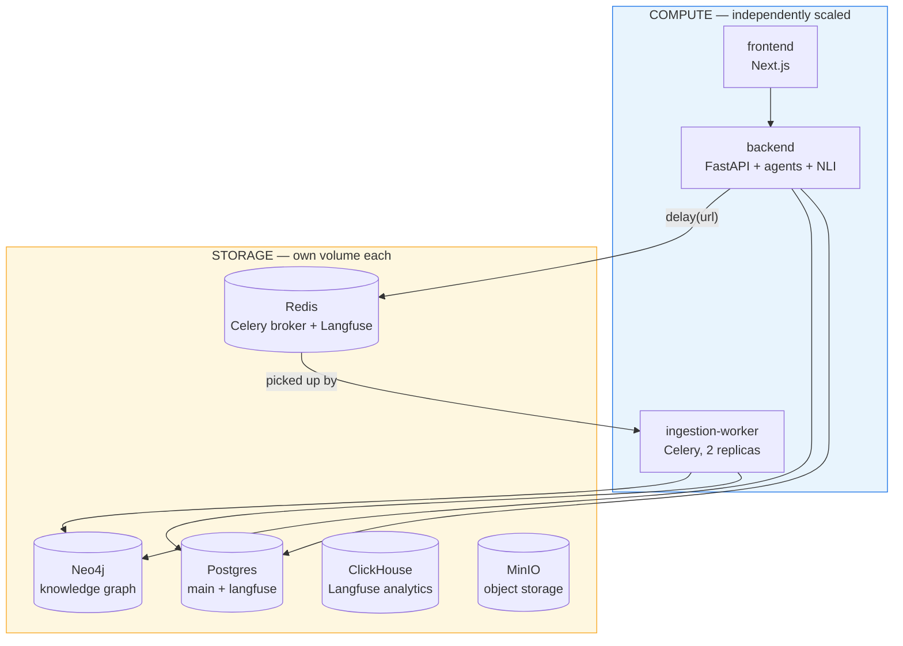

# Docker Deployment & Compute/Storage Separation

This document covers the Docker setup for this project: containerizing
the backend (FastAPI) and frontend (Next.js), separating ingestion
compute from API compute, and every real issue hit while actually
running the stack — plus a step-by-step guide that avoids all of them.

---

## 1. Architecture



Each compute service has its own `deploy.resources` limits (manual
knobs, not autoscaling); each storage service has its own named
volume. Ingestion is decoupled from the API path: `research.py`
dispatches `ingest_url_task.delay(url)` to Redis and returns
immediately; the `ingestion-worker` service (Celery) picks it up and
does the scrape/chunk/embed/graph-write work independently.

---

## 2. Known issues hit while actually running this, and the fix for each

Every one of these is already fixed in the current files. Listed here
so a future rebuild-from-scratch (new machine, wiped image cache) has
a reference if any resurface.

### 2.1 `minio/mc` / `minio/minio` — pull access denied

**Symptom:** `Error response from daemon: pull access denied for
minio/mc, repository does not exist or may require 'docker login'` —
happens even after a successful `docker login`.

**Cause:** MinIO removed its images from Docker Hub entirely (mid-Sept
2026). `docker login` succeeding doesn't help because there's no
repository left to authenticate against — Docker Hub returns the same
generic error whether a repo is private or simply gone.

**Fix:** point both images at `quay.io` instead:
```yaml
minio:
  image: quay.io/minio/minio:latest
minio-init:
  image: quay.io/minio/mc:latest
```

### 2.2 `psycopg2` fails to build — `pg_config executable not found`

**Symptom:** `docker compose up --build` fails during
`uv sync --frozen --no-install-project --no-dev` with `Failed to build
psycopg2==2.9.12` / `pg_config executable not found`.

**Cause:** `psycopg2` (not `-binary`) compiles a C extension against
PostgreSQL's client headers at install time. The builder stage has no
`libpq-dev`/build tools installed.

**Fix:** use `psycopg2-binary` instead — same `import psycopg2` in
code, no code changes needed, pre-compiled wheel, no build tools
required:
```toml
"psycopg2-binary>=2.9.12",
```
(then `uv lock` to regenerate the lockfile — see 2.6)

### 2.3 `torch` pulls multi-GB NVIDIA CUDA libraries for a CPU-only grader

**Symptom:** not an error, just a much bigger/slower build than
necessary. PyPI's default `torch` wheel on Linux bundles
`nvidia-cublas-cu12`, `nvidia-cudnn-cu12`, etc. — several GB nobody
uses, since this container has no GPU passthrough configured.

**Fix:** pin `torch` to PyTorch's official CPU-only wheel index in
`pyproject.toml`:
```toml
[tool.uv.sources]
torch = [{ index = "pytorch-cpu" }]

[[tool.uv.index]]
name = "pytorch-cpu"
url = "https://download.pytorch.org/whl/cpu"
explicit = true
```

### 2.4 Neo4j crashes on boot — `Unrecognized setting. No declared setting with name: PASSWORD`

**Symptom:** `neo4j` container starts, immediately fails validation,
loops trying to reinstall the APOC plugin, never becomes healthy.
`backend` then fails too (`dependency neo4j failed to start`).

**Cause:** the Neo4j image auto-converts *any* `NEO4J_*` environment
variable into a `neo4j.conf` setting. The `neo4j` service used
`env_file: - .env`, which loaded **all** of `docker/.env` — including
`NEO4J_USERNAME`/`NEO4J_PASSWORD` (added only for the *backend app* to
read). Neo4j doesn't recognize those as config keys and refuses to
start.

**Fix:** don't blanket-load `docker/.env` into the `neo4j` service.
Pass only what Neo4j itself needs, explicitly:
```yaml
neo4j:
  environment:
    NEO4J_AUTH: "${NEO4J_AUTH}"
    NEO4J_PLUGINS: "${NEO4J_PLUGINS}"
  # no env_file here
```
`backend`/`ingestion-worker` are unaffected — they still get
`NEO4J_USERNAME`/`NEO4J_PASSWORD` via their own `env_file`.

> If you hit this on a volume that already exists in a broken state,
> `docker compose down` and remove the neo4j volumes before retrying:
> `docker volume rm docker_neo4j_data docker_neo4j_logs docker_neo4j_config`

### 2.5 Neo4j healthcheck times out even when Neo4j is fine

**Symptom:** `neo4j` container runs but Compose marks it unhealthy
before it finishes starting.

**Cause:** no `start_period` on the healthcheck. Neo4j with
`NEO4J_PLUGINS='["apoc"]'` downloads/installs APOC on first boot,
which can take longer than the default `interval × retries` window.

**Fix:**
```yaml
healthcheck:
  test: ["CMD-SHELL", "wget -O /dev/null -q http://localhost:7474 || exit 1"]
  interval: 10s
  timeout: 5s
  retries: 20
  start_period: 90s
```

### 2.6 `uv sync --frozen` fails after any `pyproject.toml` edit

**Symptom:** `Failed to sync: lockfile out of date` (or similar) as
soon as the build reaches `uv sync --frozen`.

**Cause:** `--frozen` requires `uv.lock` to exactly match
`pyproject.toml`. Every dependency change (adding `celery[redis]`,
switching to `psycopg2-binary`, pinning the CPU-only torch index) must
be followed by regenerating the lockfile — it doesn't happen
automatically.

**Fix:** from `backend/`, on your machine (not inside Docker), after
*any* `pyproject.toml` change:
```bash
uv lock
```

### 2.7 Celery task connects to `localhost` instead of Redis

**Symptom:** manually testing `ingest_url_task.delay(...)` from inside
the `backend` container raises `ConnectionRefusedError: [Errno 111]
Connection refused`, with a `kombu.transport.pyamqp` traceback — AMQP,
not Redis — and a `No hostname was supplied. Reverting to default
'localhost'` warning.

**Cause:** `ingestion_tasks.py` used `@shared_task` (Celery's *ambient
default app*), not `@celery_app.task` (our configured app). Running
`celery -A src.tasks.celery_app worker` happens to import
`celery_app.py` first, so it works there — but importing
`ingestion_tasks` directly (e.g. for a manual test) never touches
`celery_app.py`, so `@shared_task` falls back to Celery's built-in
defaults (AMQP broker on localhost), regardless of what
`celery_app.py` configures.

**Fix:** bind the task to the app explicitly, and have `celery_app.py`
declare the task module via `include=` instead of importing it at the
bottom (avoids a circular import now that `ingestion_tasks.py` imports
`celery_app`):

`celery_app.py`:
```python
celery_app = Celery(
    "ai_regulation_ingestion",
    broker=CELERY_BROKER_URL,
    backend=CELERY_BROKER_URL,
    include=["src.tasks.ingestion_tasks"],
)
```

`ingestion_tasks.py`:
```python
from src.tasks.celery_app import celery_app

@celery_app.task(
    name="ingest_url",
    bind=True,
    autoretry_for=(Exception,),
    retry_backoff=True,
    retry_backoff_max=60,
    max_retries=3,
)
def ingest_url_task(self, url: str) -> dict:
    ...
```

### 2.8 `langfuse-web` crash-loops — `JavaScript heap out of memory`

**Symptom:** `docker compose logs langfuse-web` shows a repeating cycle
of Prisma migrations running, Next.js starting, MCP features
registering, then `FATAL ERROR: Ineffective mark-compacts near heap
limit ... JavaScript heap out of memory` — over and over
(`restart: always` keeps bringing it back up just to OOM again).
`docker compose ps` shows a suspiciously short uptime for
`langfuse-web` compared to the rest of the stack.

**Cause:** the original `LANGFUSE_WEB_MEMORY` default (`1g`) is too
small for Langfuse v3's actual Node.js process — Prisma + many
registered MCP features need more headroom than that.

**Fix:** raise the limit and cap Node's own heap so it fails
predictably under the container limit instead of hitting Docker's OOM
killer:
```dotenv
# docker/.env
LANGFUSE_WEB_MEMORY=2g
```
```yaml
# docker-compose.yaml
langfuse-web:
  environment:
    NODE_OPTIONS: "--max-old-space-size=1536"
```
Then: `docker compose up -d --force-recreate langfuse-web`

### 2.9 Playwright/Chromium not found — `Executable doesn't exist at /home/appuser/.cache/ms-playwright/...`

**Symptom:** `ingestion-worker` (or `backend`, before ingestion moved
out) fails at ingestion time with a Playwright `BrowserType.launch`
error, even though `playwright install --with-deps chromium` ran
successfully during the build.

**Cause:** the Dockerfile installs Chromium as `root` (default cache
path `/root/.cache/ms-playwright`), then switches to a non-root
`appuser` to actually run the app. `appuser` looks for the browser
under *its own* home directory, where it was never installed.

**Fix:** pin the browser install path to a shared, explicitly
`chown`'d location instead of relying on the default per-user cache:
```dockerfile
ENV PLAYWRIGHT_BROWSERS_PATH="/ms-playwright"

RUN playwright install --with-deps chromium

RUN useradd --create-home --shell /bin/bash appuser \
    && chown -R appuser:appuser /app \
    && chmod -R 755 /ms-playwright

USER appuser
```
Rebuild after this change (it's a Dockerfile edit, not just config):
```bash
docker compose up -d --build backend ingestion-worker
```

---

## 3. First-time setup — step by step

Follow in order. Every step here exists specifically to avoid one of
the issues in Section 2 — skipping ahead is how they resurface.

### 3.1 Install Docker Desktop

Download from docker.com, install, start it. Verify:
```bash
docker --version
docker compose version
```
Give it enough resources: **Settings → Resources** — at least 8GB RAM
total for this stack (backend alone wants up to 4GB while it holds the
NLI model; Postgres, Neo4j, ClickHouse, Langfuse add up fast).

### 3.2 Place the files

| File | Goes to |
|---|---|
| `backend/Dockerfile`, `.dockerignore` | `backend/` |
| `frontend/Dockerfile`, `.dockerignore` | `frontend/` |
| `docker-compose.yaml`, `docker-compose.prod.yaml` | `docker/` |
| `.env.example`, `.gitignore` | `docker/` |
| `postgres-init/001-create-main-db.sql` | `docker/postgres-init/` |
| `celery_app.py`, `ingestion_tasks.py` | `backend/src/tasks/` |
| `research.py` | `backend/src/agent/tools/` |
| `pyproject.toml` | `backend/` |

Create the one file not included in any drop: `backend/src/tasks/__init__.py`
(empty — needed for Celery to import the package at all).

### 3.3 Regenerate the lockfile

`pyproject.toml` has changed (celery, psycopg2-binary, CPU-only
torch). From `backend/`, on your machine:
```bash
uv lock
```
Skipping this reproduces issue 2.6.

### 3.4 Set up both `.env` files

```bash
cd docker
copy .env.example .env
```
Fill in real values — check for leftover placeholders before building:
```powershell
Select-String -Path .env -Pattern "your_"
```
This should return nothing. Also fill the three keys that start
**empty** by default (`SALT`, `NEXTAUTH_SECRET`, `ENCRYPTION_KEY`) —
Langfuse needs real values here, not blanks:
```powershell
[Convert]::ToHexString((1..32 | ForEach-Object { Get-Random -Minimum 0 -Maximum 256 }))   # ENCRYPTION_KEY (64 hex chars)
[Convert]::ToBase64String((1..32 | ForEach-Object { Get-Random -Minimum 0 -Maximum 256 })) # NEXTAUTH_SECRET, and again for SALT
```

Also confirm `backend/.env` exists (created before any Docker work —
not part of this file drop) and has real values for
`OPENROUTER_API_KEY`, `VOYAGE_API_KEY`, `TAVILY_API_KEY`. Without it,
`docker compose up` fails immediately with an "env file not found" or
missing-key error — it never reaches the build step.

### 3.5 Build

```bash
docker compose up -d --build
```
First run is slow (torch, transformers, Playwright/Chromium,
node_modules — expect 15-20+ minutes depending on connection/disk).
Subsequent builds reuse Docker's layer cache and are much faster.

### 3.6 Verify every service is actually healthy

```bash
docker compose ps
```
Every row should say `healthy` or `running` — not `unhealthy`,
`exited`, or a suspiciously short uptime compared to the rest of the
stack (that pattern specifically means a crash loop — see 2.8).

If anything looks wrong:
```bash
docker compose logs --tail=50 <service_name>
```

### 3.7 Confirm ingestion actually reaches Redis and the worker

```bash
docker compose exec backend python -c "from src.tasks.ingestion_tasks import ingest_url_task; r = ingest_url_task.delay('https://example.com'); print('TASK_ID:', r.id)"
docker compose logs --tail=20 ingestion-worker
```
The worker log should show the task being received and executed — not
a `ConnectionRefusedError` (see 2.7 if it does).

### 3.8 Hit the actual endpoints

- Backend: `http://localhost:8000/health` → `{"status": "healthy", ...}`
- Frontend: `http://localhost:5000`
- Langfuse dashboard: `http://localhost:3000`

---

## 4. Production overlay

```bash
docker compose -f docker-compose.yaml -f docker-compose.prod.yaml up -d
```
Removes host-port publishing for internal-only services
(postgres/neo4j/redis/clickhouse/minio) and adds log rotation, without
changing the dev-friendly defaults in the base file.

> If `docker/.env` was ever committed to git before the `.gitignore`
> fix, check `git log --all --full-history -- docker/.env` and rotate
> every secret in it if it shows up.

---


## 5. File map

| File | What it is |
|---|---|
| `backend/Dockerfile` | Backend image build (Playwright, non-root user, `/health` HEALTHCHECK) |
| `backend/.dockerignore` | Keeps `.env`/secrets out of the build context |
| `frontend/Dockerfile` | Frontend image build (`NEXT_PUBLIC_*` as build ARGs) |
| `frontend/.dockerignore` | Same, for frontend |
| `docker/docker-compose.yaml` | Full stack, resource limits on every service |
| `docker/docker-compose.prod.yaml` | Production overlay |
| `docker/postgres-init/001-create-main-db.sql` | Creates the `main` database on first boot |
| `docker/.gitignore` | Protects `docker/.env` |
| `docker/.env.example` | Template for all required environment variables |
| `backend/src/tasks/celery_app.py` | Celery app + Redis broker config |
| `backend/src/tasks/ingestion_tasks.py` | The retryable ingestion task |
| `backend/src/agent/tools/research.py` | Dispatches ingestion jobs via `.delay()` |
| `backend/pyproject.toml` | Dependencies (CPU-only torch, `psycopg2-binary`, `celery[redis]`) |
