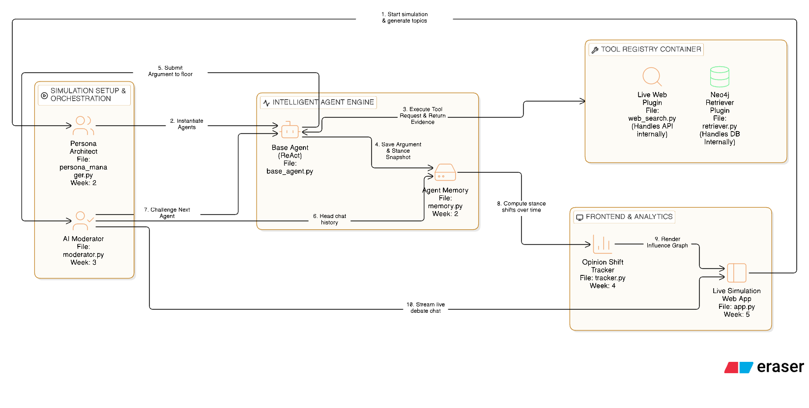

# Intelligent Agent Framework Architecture

## 1. Overview

This document outlines the architecture for the autonomous AI agents driving the **Qubeterra AI NextGen (Theme 1)** policy simulation.

Our architecture moves beyond simple stateless chatbots. We utilize a **ReAct (Reason + Act) Agent Framework** equipped with dynamic personas, persistent memory, and modular tool access (Graph RAG via Neo4j) to generate highly grounded, evidence-based arguments regarding AI Regulation.

## 2. Architecture Blueprint

_The diagram above illustrates the end-to-end data flow, from scenario setup through the agent's internal reasoning loop, down to tool execution and memory persistence._

---

## 3. Core Components

To ensure high modularity and scalability for the upcoming Week 3 Multi-Agent debates, the agent framework is strictly divided into four core components:

### A. Configurable Personas (The Identity)

- **Purpose:** Ensures the agent adopts a specific stakeholder identity (e.g., "Pro-Innovation SME Founder" vs. "EU Civil Rights Regulator") without hardcoding logic into the agent class.
- **Implementation:** Personas are structured schemas defining `Name`, `Background`, `Stance`, and `Tone`. They are injected directly into the `BaseAgent`'s system prompt at runtime.
- **Modularity:** Personas can be loaded from static YAML files (`personas/*.yaml`) or generated dynamically on-the-fly by a Scenario Architect LLM to allow infinite simulation varieties.

### B. The Reasoning Loop (The Brain)

- **Purpose:** The core engine that processes incoming challenges, decides what facts are missing, calls tools, and formulates a final opinion.
- **Implementation:** We use the **ReAct (Reason + Act)** pattern inside `base_agent.py`.
  - **Thought:** The LLM analyzes the prompt and realizes it needs facts.
  - **Action:** The LLM emits a tool call (e.g., `search_ai_policy`).
  - **Observation:** The backend executes the tool and feeds the data back into the context window.
  - **Final Answer:** The LLM synthesizes the observation into a grounded policy argument.

### C. Modular Tools (The Hands)

- **Purpose:** Provides the agent with read-access to the external world to prevent hallucinations.
- **Implementation:** Tools are decoupled from the agent logic via a `Tool Registry` (`tool_registry.py`).
  1.  **Knowledge Retriever (`retriever.py`):** Executes vector similarity searches against our Week 1 **Neo4j Database** to fetch verified excerpts from the EU AI Act.
  2.  **Live Web Search (`web_search.py`):** Fetches real-time tech news and external policy updates.
- **Modularity:** Because the `BaseAgent` only interacts with the registry, we can add or remove tools effortlessly without breaking the agent loop.

### D. Agent Memory (The Ledger)

- **Purpose:** Provides persistent state so agents maintain ideological consistency across multiple rounds of debate and do not forget past arguments.
- **Implementation:** A local SQLite/JSON store (`memory.py`).
- **Opinion Tracking:** Memory stores more than just chat transcripts. It logs **Opinion Snapshots**—including the text, the specific Neo4j sources cited, and a hidden numerical "Stance Score" (1-10) used by our analytics engine to track how stakeholders influence each other over time.

---

## 4. The Query Flow: Step-by-Step

When a user (or the AI Moderator) asks an agent to form an initial opinion, the request flows through the architecture as follows:

1.  **Initialization:** The `PersonaManager` loads the persona data and instantiates the `BaseAgent`. The agent builds its System Prompt combining general simulation rules and persona traits.
2.  **Prompting:** The user prompt (e.g., _"What is your stance on High-Risk AI?"_) is sent to the **Reasoning Loop**.
3.  **Tool Request:** The LLM determines it needs legal context and emits a JSON schema requesting the `search_ai_policy` tool.
4.  **Tool Execution:** The `Tool Registry` intercepts the request, runs the vector search on the **Neo4j Database**, and returns the textual policy evidence.
5.  **Feedback & Synthesis:** The retrieved evidence is appended to the LLM's context window as an "Observation." The LLM executes a final pass to generate a strictly grounded argument citing those specific sources.
6.  **Persistence:** The final generated opinion, the cited sources, and the agent's current stance score are saved to **Agent Memory** for future rounds.
7.  **Output:** The final argument is returned to the UI or saved to `outputs/initial_opinions.json`.
